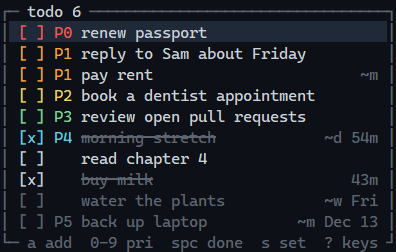

# desktop-todo

A small, keyboard-driven to-do list that sits on your Windows desktop, drawn like a terminal UI.



- **One file, no dependencies.** Python's standard library only. Nothing to `pip install`.
- **Priorities** `P0`–`P9`, colour-coded and sorted to the top.
- **Repeating tasks** (daily, weekly, monthly) step aside until they're next due.
- **Finished tasks linger** struck through with a countdown, then move to a done log that keeps the newest 500.
- **Any text**: emoji and CJK titles keep the box lined up.
- **Themes** (dark, amber, green), adjustable font size and width, always-on-top, start at login.
- **Plain JSON storage**, written atomically. A damaged file is set aside, never overwritten.

## Requirements

- Windows 10 or 11
- Python 3.10 or newer, with Tkinter. The [python.org installer](https://www.python.org/downloads/windows/) includes it.

## Install

```
git clone https://github.com/jdsteel61/desktop-todo.git
```

Or download **Source code (zip)** from the [latest release](https://github.com/jdsteel61/desktop-todo/releases/latest)
and unzip it. Then double-click `todo.pyw`.
The `.pyw` extension runs it without a console window.

To have it open when you sign in, press `s` and turn on **start at login**.

## Use

Press `a` and type a task. A `p0`–`p9` at the start or end sets its priority.
`/daily`, `/weekly` or `/monthly` (or `/d`, `/w`, `/m`) makes it repeat:

```
p1 pay rent /monthly
```

| Key | Action |
| --- | --- |
| `a` | add a task |
| `Enter` `F2` `e` | rename the selected task |
| `Space` `x` | mark done / undo |
| `0`–`9` | set priority (press the same digit again to clear it) |
| `+` `-` | raise / lower priority |
| `r` | cycle repeat: none → daily → weekly → monthly |
| `d` `d` | delete |
| `c` | move finished tasks to the done log now |
| `j` `k` / `↓` `↑` | move the selection |
| `Tab` | switch to the done log and back |
| `s` | settings (`←` `→` to change a value) |
| `?` | key help |
| `Esc` | back to the list |
| `q` | quit |

With the mouse, click a checkbox to tick it. Click a selected task, or double-click any task, to rename it.
Drag the top border to move the window, and use the scroll wheel to move the selection.

A repeating task that you finish comes back on its next date: tomorrow, in a week, or on the same day next month.
Until then it waits, dimmed, at the bottom of the list. Tick it to bring it forward to today.

## Your data

Tasks and settings are saved to `data.json` next to `todo.pyw`. Git ignores that file, so `git pull` won't touch it.

To keep it somewhere else, such as a synced folder, set the `TODO_DATA` environment variable to a file path.
If you also use **start at login**, set it as a user environment variable in Windows settings so the login launch sees it.
Only one window runs per data file. Launching it again while it's open does nothing.

If the file can't be read, it's renamed to `data.bad-<date>-<time>.json` and the app starts with an empty list.

## Uninstall

Turn off **start at login** in settings. That removes the `desktop-todo` entry under
`HKEY_CURRENT_USER\Software\Microsoft\Windows\CurrentVersion\Run`. Then delete the folder.

## Development

```
python -m unittest discover -s tests -v
ruff check .
```

The tests cover parsing, scheduling and loading the data file, and don't open a window.
To propose a change, see [CONTRIBUTING.md](CONTRIBUTING.md).

## License

[MIT](LICENSE)
